<div align="center">

# AR-LRF Phishing URL Lab

**Adversarially-robust, lightweight phishing URL detection, plus an interactive lab to scan URLs, attack the models and inspect every result.**


-F2600C)


<picture>
  <source media="(prefers-color-scheme: light)" srcset="docs/screenshots/overview-light.jpg">
  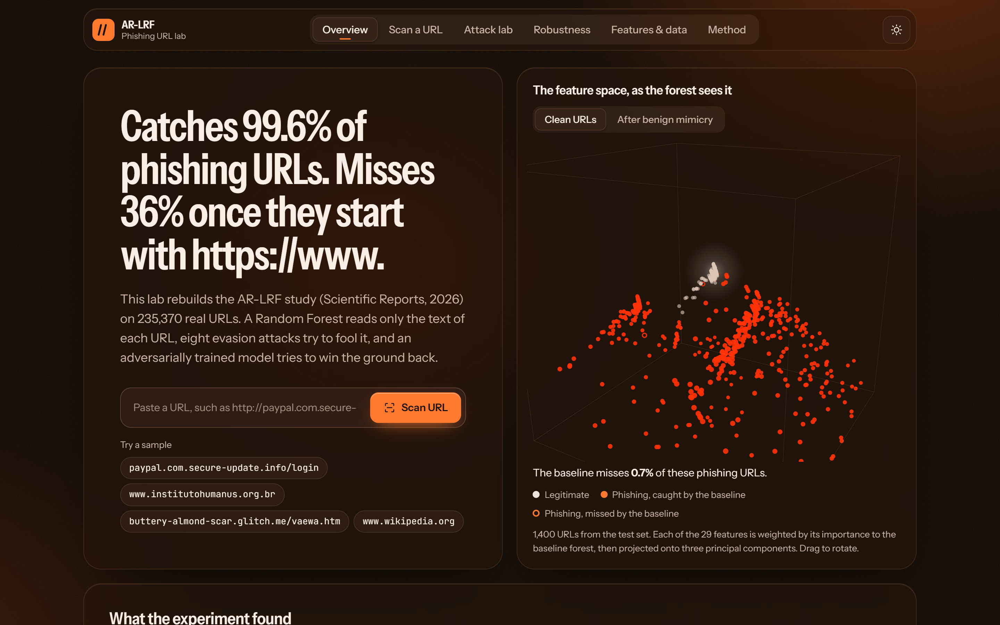
</picture>

</div>

A simplified replication of *"Adversarial-resilient lightweight phishing URL detection: Evaluating lexical & metadata features under evasion techniques"* (Scientific Reports 16, 26668, 2026) on the public PhiUSIIL Phishing URL dataset. A Random Forest reads **only the text of a URL**. Eight evasion attacks try to fool it, and an adversarially trained AR-LRF tries to win the ground back.

See **[report.md](report.md)** for the full assignment report.

## At a glance

| | |
|---|---|
| **99.6%** | of phishing URLs caught by the baseline Random Forest on the clean test set |
| **63.6%** | caught once the same URLs are forced to `https://www.` (benign mimicry) |
| **95.4%** | caught by AR-LRF under the combined attack, against 63.6% for the baseline |
| **99.75%** | accuracy from a depth-3 tree that sees only *https*, *www* and *path length*: the dataset's shortcut |
| **235,370** | unique URLs, 29 lexical features, no DNS, WHOIS or page fetch |

<div align="center">
  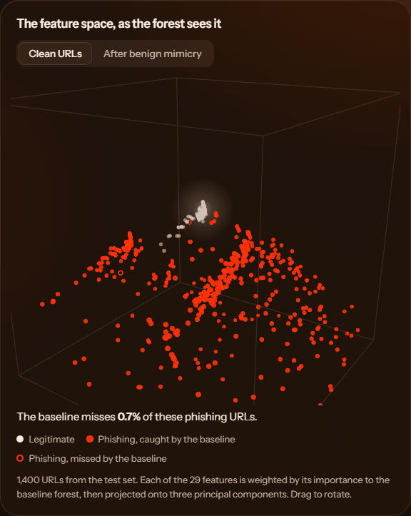
  <br>
  <sub>1,400 test URLs in the feature space the forest uses. Applying benign mimicry moves phishing URLs (orange) into the legitimate cluster (white). Rings are the ones the baseline then misses.</sub>
</div>

## Contents

- [Quick start](#quick-start)
- [The web interface](#the-web-interface)
- [How it works](#how-it-works)
- [The eight attacks](#the-eight-attacks)
- [Results](#results)
- [Architecture of the interface](#architecture-of-the-interface)
- [API](#api)
- [Project layout](#project-layout)
- [Limitations](#limitations)
- [Reference](#reference)

## Quick start

```bash
pip install -r requirements.txt

python src/experiment.py          # 5–15 min on a laptop CPU: downloads data, trains, attacks, hardens, writes results/ and models/
python app/build_projection.py    # optional: rebuilds results/projection.json for the 3D view
python app/server.py              # web interface on http://127.0.0.1:8000

python src/predict.py --attacks "http://paypa1-login.example.com/verify"   # command-line demo
python -m pytest -q tests
```

> [!NOTE]
> The scanner reads only the URL string; it never fetches or opens the page, so live phishing links are safe to paste. Without `models/` the interface still runs and shows features and attack variants, just no scores. three.js and the fonts load from public CDNs.

## The web interface

Six tabs, in the order of the story: what was found, try it, attack it, measure it, explain it, reproduce it. Every screen has a light and a dark theme (the toggle sits top right and remembers your choice), and the layout holds down to phone width.

<table>
  <tr>
    <td width="50%">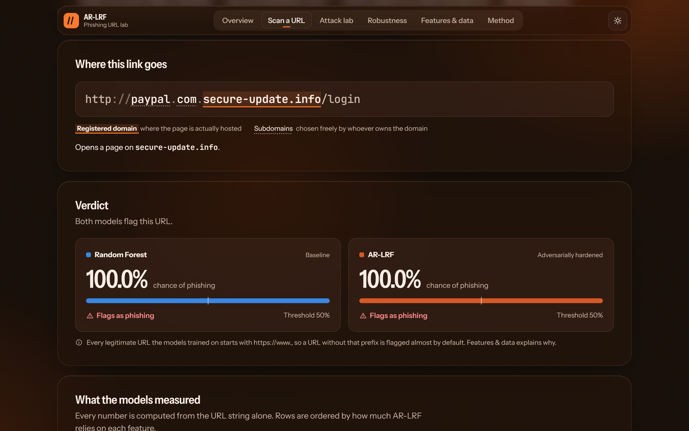</td>
    <td width="50%">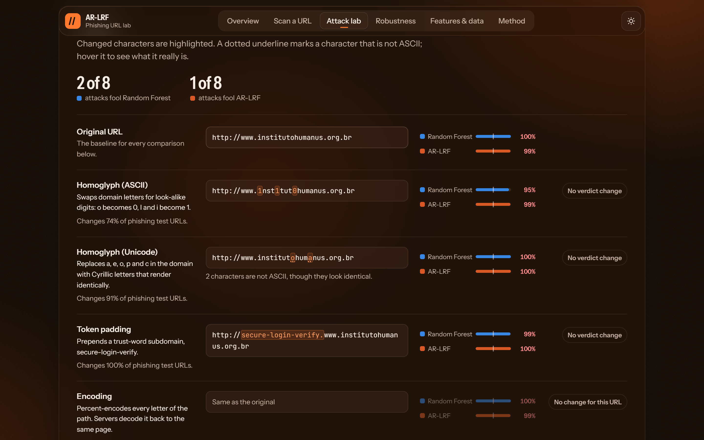</td>
  </tr>
  <tr>
    <td><b>Scan a URL</b>: where the link really goes (registered domain vs decoy subdomains vs <code>@</code> user info), both models' verdicts and the 29 features they read.</td>
    <td><b>Attack lab</b>: all eight evasions applied to the URL, with character-level diffs, Cyrillic look-alikes flagged and every variant re-scored.</td>
  </tr>
  <tr>
    <td>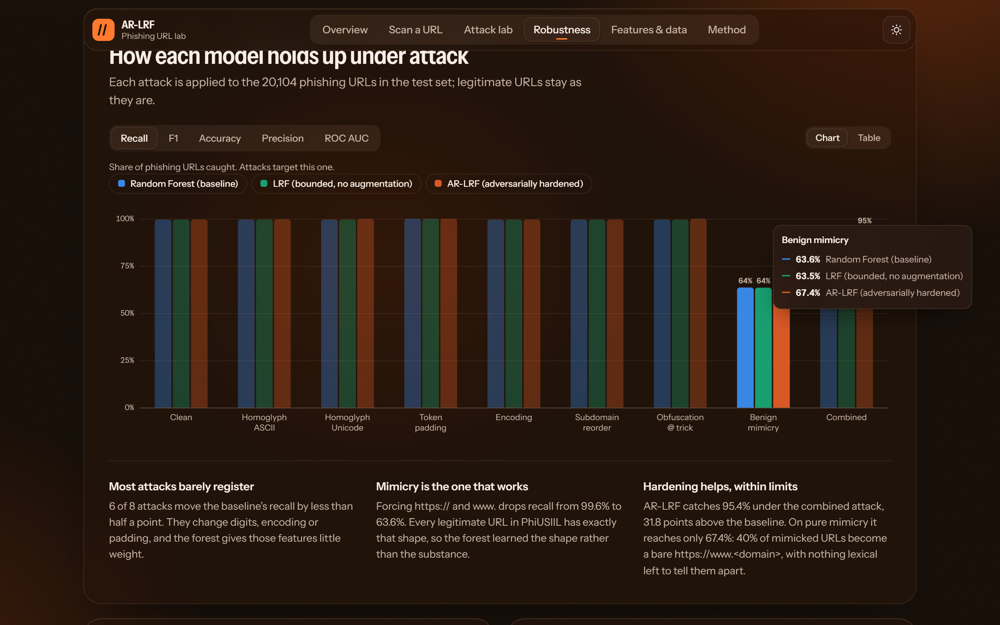</td>
    <td>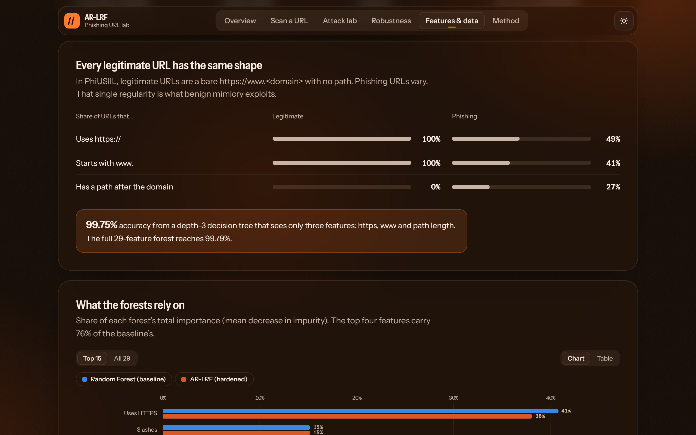</td>
  </tr>
  <tr>
    <td><b>Robustness</b>: clean vs attacked vs hardened for every metric, with chart/table views and a hover readout.</td>
    <td><b>Features &amp; data</b>: the URL-shape bias that makes mimicry work, feature importances and all 29 features explained.</td>
  </tr>
  <tr>
    <td>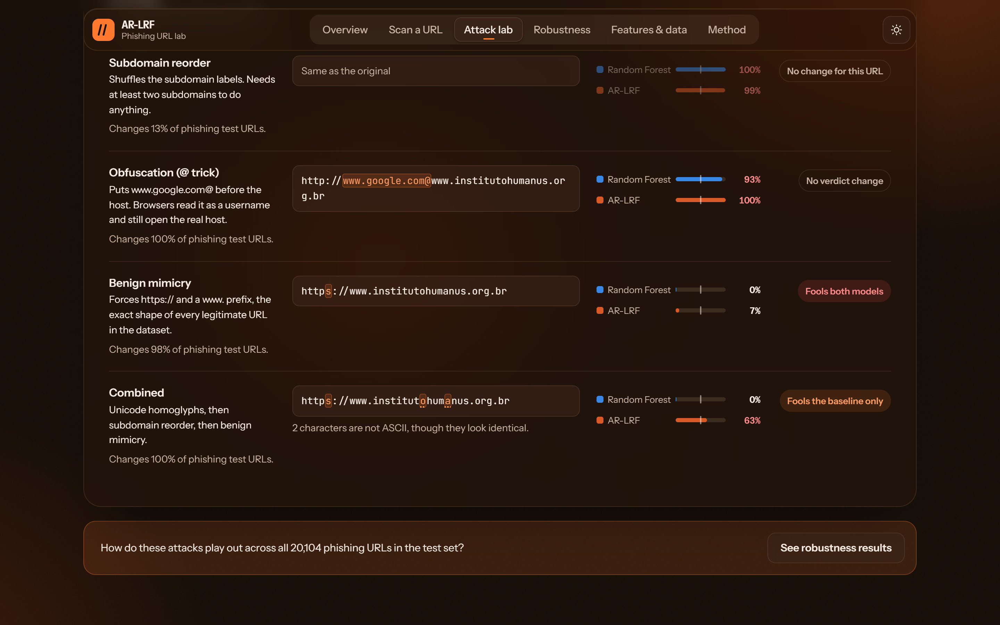</td>
    <td>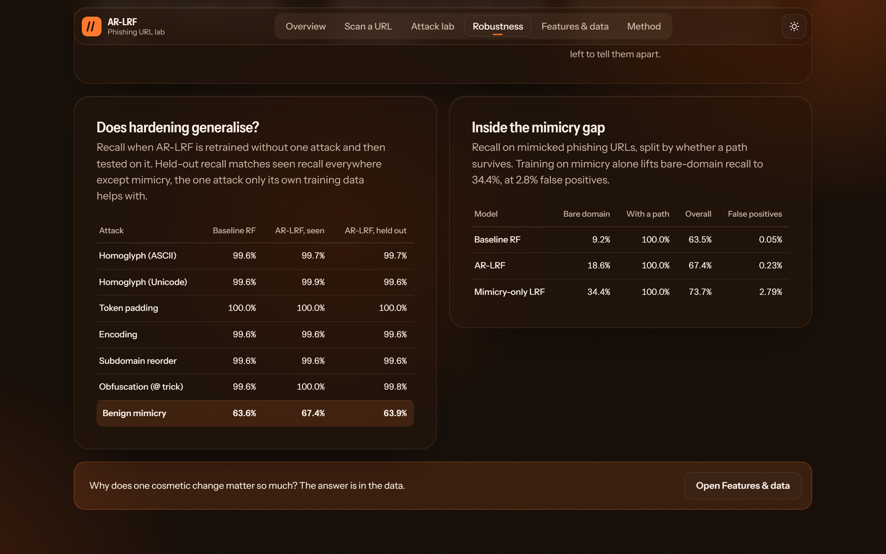</td>
  </tr>
  <tr>
    <td>One added <code>s</code> takes the baseline from 100% to 0%. AR-LRF still flags the combined attack.</td>
    <td>Leave-one-attack-out generalisation and the mimicry deep-dive.</td>
  </tr>
  <tr>
    <td>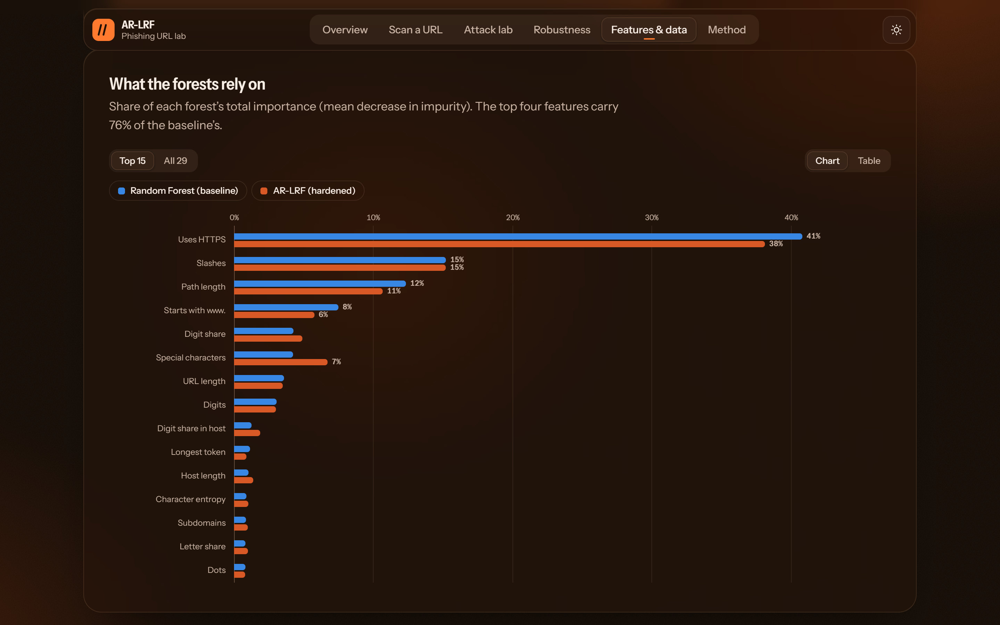</td>
    <td>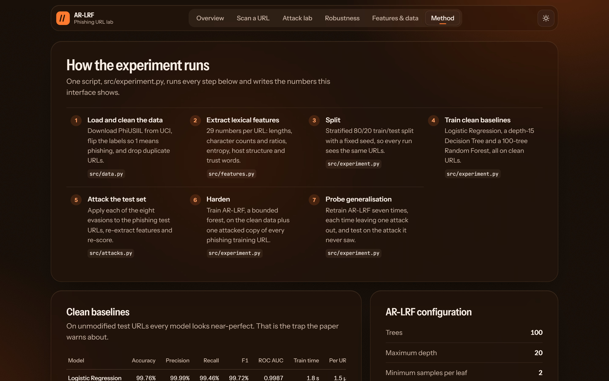</td>
  </tr>
  <tr>
    <td><b>Feature importance</b>: four features carry 76% of the baseline's decisions.</td>
    <td><b>Method</b>: the pipeline step by step, clean baselines and how to reproduce.</td>
  </tr>
</table>

<details>
<summary><b>Phone layout and light mode</b></summary>
<br>
<table>
  <tr>
    <td width="25%">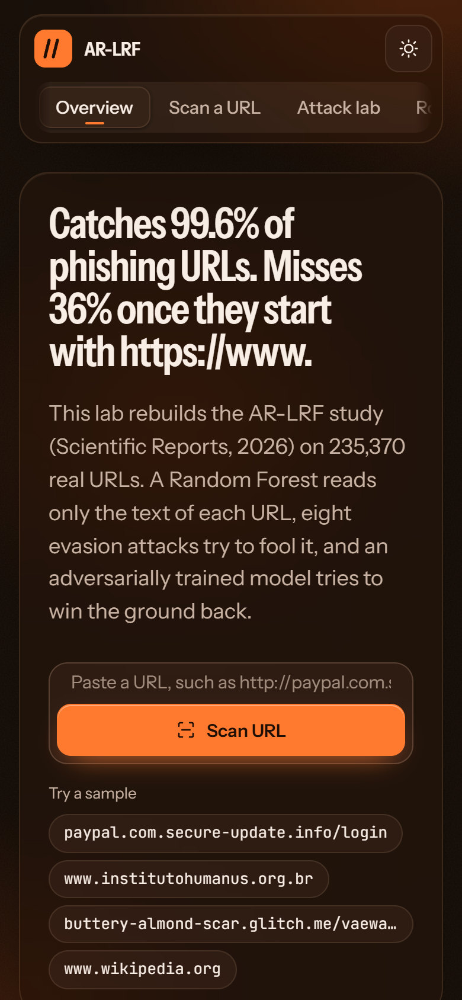</td>
    <td width="25%">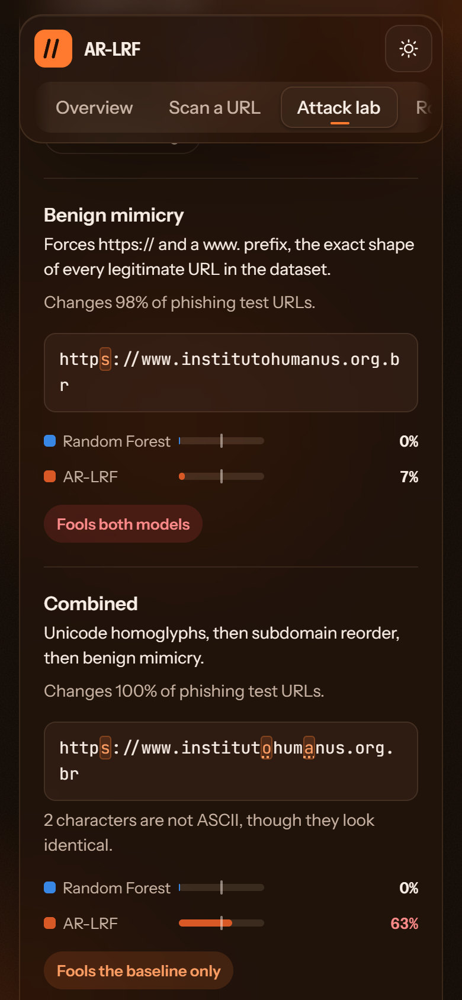</td>
    <td width="50%">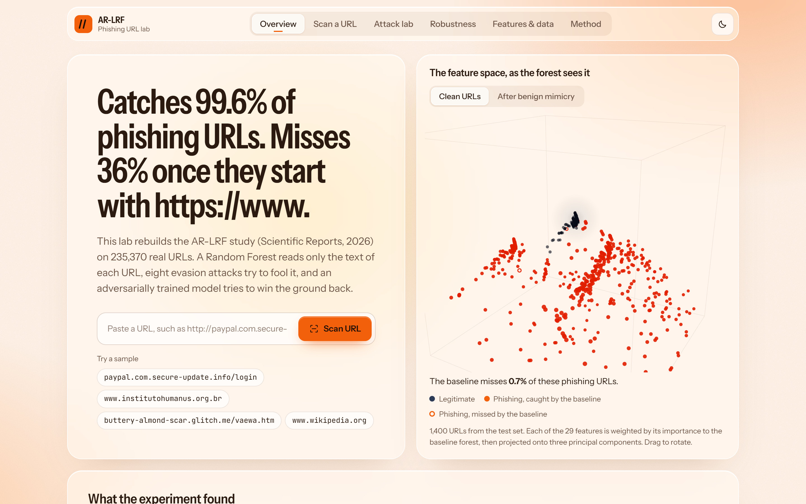</td>
  </tr>
</table>
</details>

**Design notes.** Warm glass panels over an apricot (light) or ember (dark) field, with a signal-orange accent. Instrument Sans for text and JetBrains Mono only for URLs, where every character matters. Chart colours (blue = baseline RF, aqua = LRF, orange = AR-LRF) are checked for colour-blind separation in both themes. Plain ES modules, no build step.

## How it works

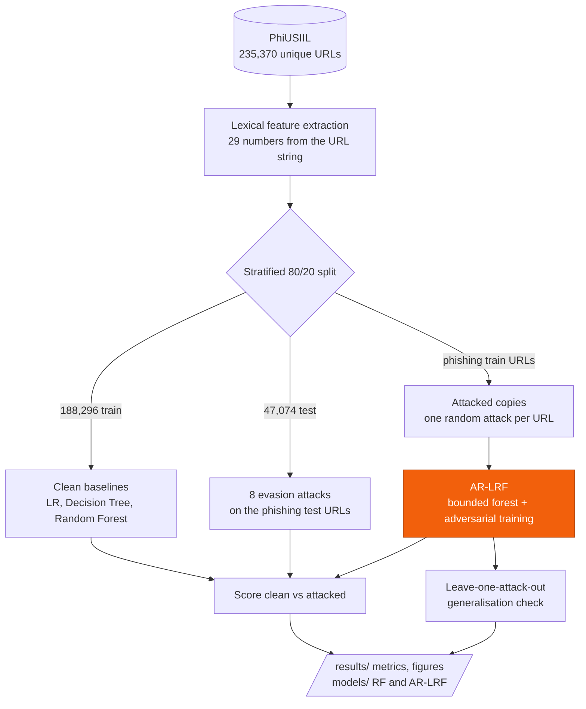

**Threat model.** The attacker may rewrite the URL string freely as long as the link still works: they own the domain, its subdomains and the path. The defender sees only the URL text: no page rendering, DNS, WHOIS or reputation feeds, which keeps detection fast and private.

**Features.** 29 numbers per URL, in four groups:

| Group | Count | Examples |
|---|---|---|
| Length | 6 | URL, host, path and query length, longest token, TLD length |
| Characters | 12 | dots, hyphens, slashes, digits and their share, special characters, entropy, `%` signs, non-ASCII characters |
| Host | 8 | subdomains, `www.` prefix, IP host, explicit port, punycode, `@` in the URL, digits and hyphens in the host |
| Scheme and query | 3 | HTTPS, query parameters, trust words such as *login*, *verify*, *secure* |

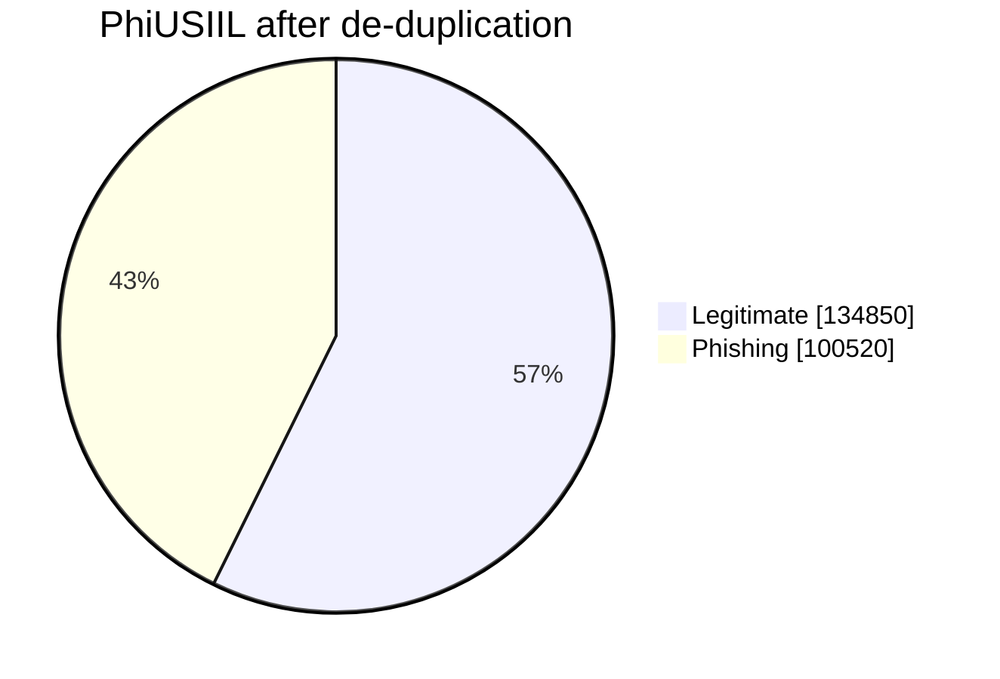

> [!IMPORTANT]
> Every legitimate URL in PhiUSIIL is a bare `https://www.<domain>`: 100% use HTTPS, 100% start with `www.`, 0% have a path. Phishing URLs do so only 48.6%, 41.5% and 27.1% of the time. The forests learn that shape, so the one attack that copies it (benign mimicry) is the one that works.

## The eight attacks

Each attack is applied to every phishing URL in the test set. The rewritten URL goes back through the feature extractor, so the attack moves the feature vector the way it would in the wild. Examples are real outputs of [`src/attacks.py`](src/attacks.py):

| Attack | `http://login.secure.paypal.com/account/verify` becomes | Changes |
|---|---|---|
| Homoglyph (ASCII) | `http://login.secure.paypa1.com/account/verify` | 74% |
| Homoglyph (Unicode) | `http://login.secure.раyраl.com/account/verify` (Cyrillic р and а) | 91% |
| Token padding | `http://secure-login-verify.login.secure.paypal.com/account/verify` | 100% |
| Encoding | `http://login.secure.paypal.com/%61%63%63%6F%75%6E%74/%76%65%72%69%66%79` | 27% |
| Subdomain reorder | `http://secure.login.paypal.com/account/verify` | 13% |
| Obfuscation (`@` trick) | `http://www.google.com@login.secure.paypal.com/account/verify` | 100% |
| Benign mimicry | `https://www.login.secure.paypal.com/account/verify` | 98% |
| Combined | `https://www.login.secure.раyраl.com/account/verify` | 100% |

*Changes* is the share of phishing test URLs the attack actually modifies (encoding needs a path, reordering needs two or more subdomains).

## Results

**Phishing recall (detection rate) on the test set, per scenario:**

| Scenario | Random Forest | LRF (bounded) | AR-LRF (hardened) |
|---|---:|---:|---:|
| Clean | 99.6% | 99.6% | 99.6% |
| Homoglyph (ASCII) | 99.6% | 99.6% | 99.7% |
| Homoglyph (Unicode) | 99.6% | 99.6% | 99.9% |
| Token padding | 100.0% | 100.0% | 100.0% |
| Encoding | 99.6% | 99.6% | 99.6% |
| Subdomain reorder | 99.6% | 99.6% | 99.6% |
| Obfuscation (`@` trick) | 99.6% | 99.6% | 100.0% |
| **Benign mimicry** | **63.6%** | **63.5%** | **67.4%** |
| **Combined** | **63.6%** | **63.5%** | **95.4%** |

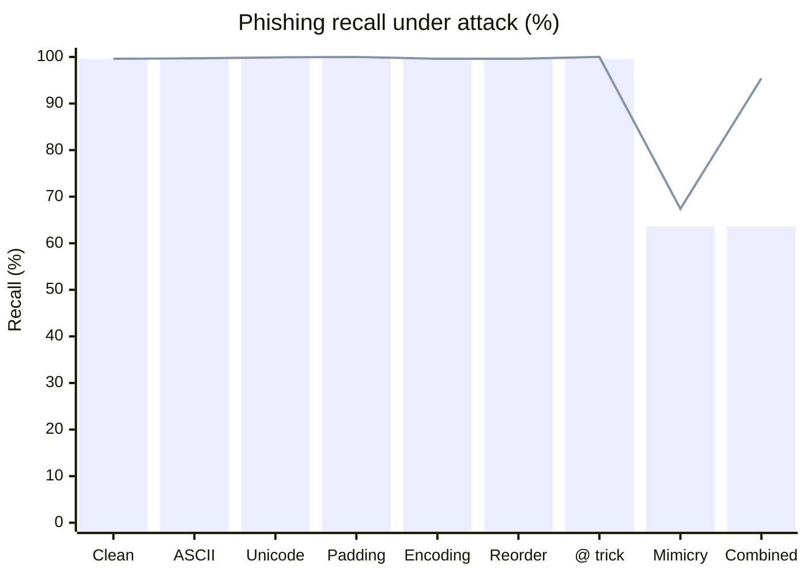
<sub>Bars: baseline Random Forest. Line: AR-LRF.</sub>

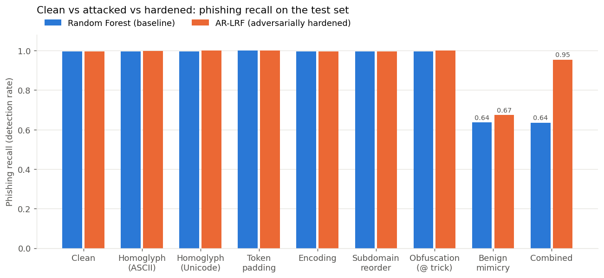

<table>
  <tr>
    <td width="50%">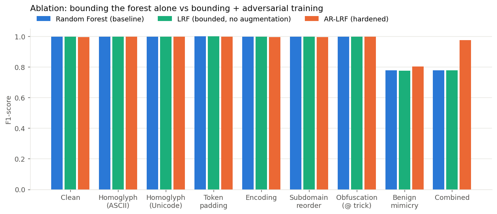</td>
    <td width="50%">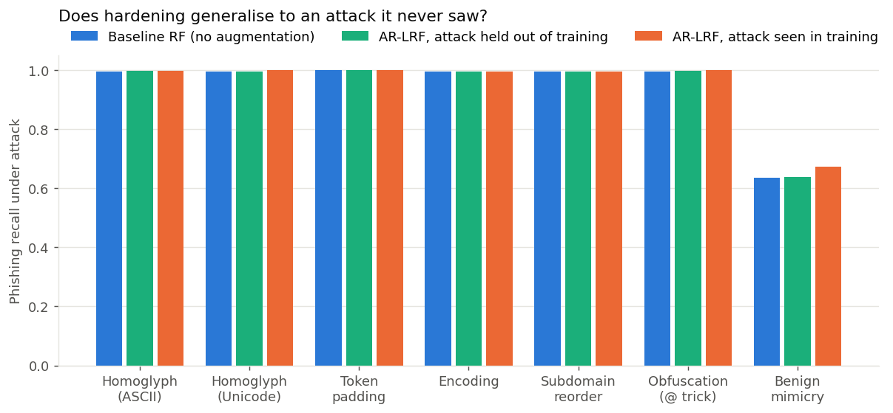</td>
  </tr>
  <tr>
    <td><b>Ablation.</b> Bounding the forest alone (LRF) changes nothing; the gain comes from adversarial training.</td>
    <td><b>Generalisation.</b> Held-out recall matches seen recall for every attack except mimicry.</td>
  </tr>
  <tr>
    <td>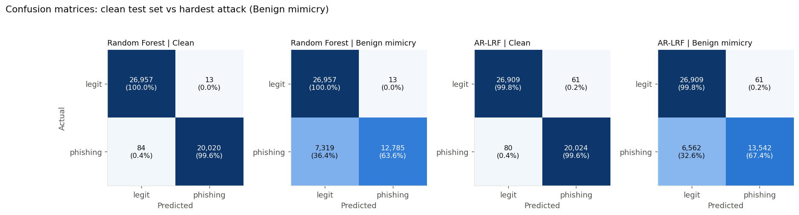</td>
    <td>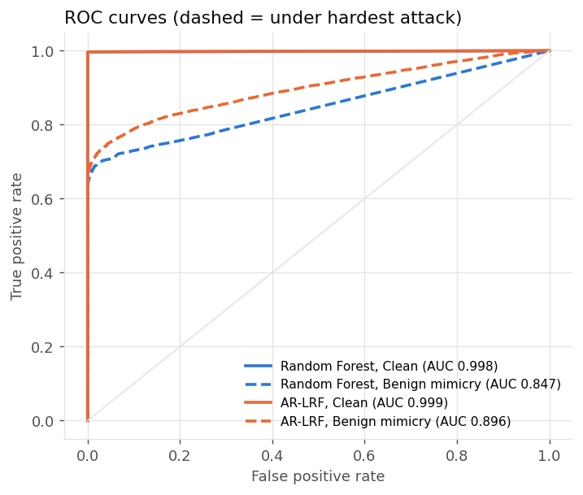</td>
  </tr>
  <tr>
    <td><b>Confusion matrices</b> on the clean test set and under the hardest attack.</td>
    <td><b>ROC curves</b>: dashed lines are under the hardest attack.</td>
  </tr>
  <tr>
    <td>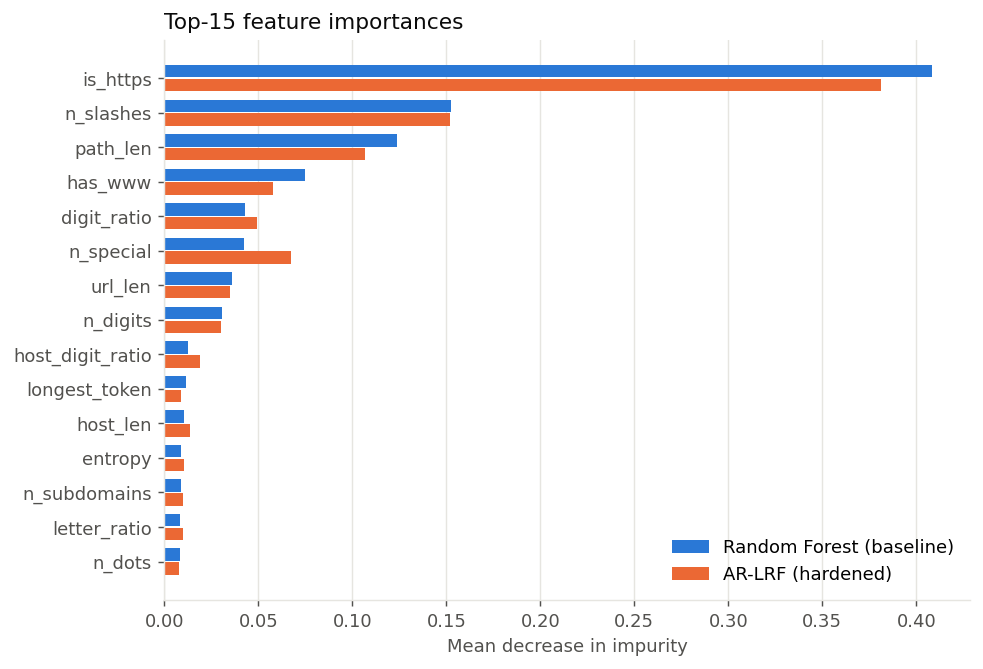</td>
    <td>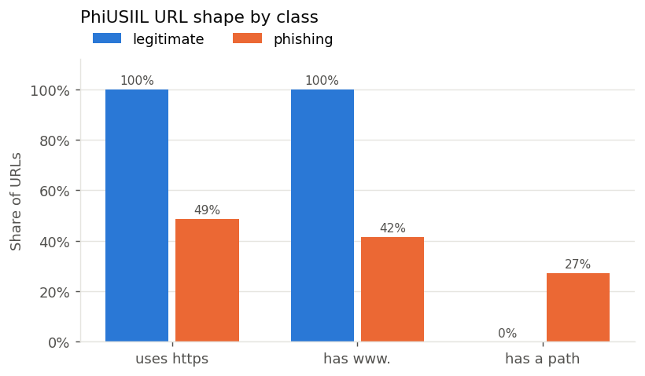</td>
  </tr>
  <tr>
    <td><b>Feature importance.</b> <code>is_https</code> alone carries about 40%.</td>
    <td><b>The shortcut.</b> Legitimate URLs all share one shape.</td>
  </tr>
</table>

**What the numbers say**

- **Most attacks barely register.** Six of eight move the baseline's recall by less than half a point. They change digits, encoding or padding, which the forest gives little weight to.
- **Mimicry is the one that works.** 40% of mimicked phishing URLs become a bare `https://www.<domain>`, identical in shape to every legitimate URL. On those, the baseline catches 9%, AR-LRF 19% and a mimicry-only model 34%, at a 2.8% false-positive cost.
- **Hardening helps, within limits.** AR-LRF recovers the combined attack (63.6% to 95.4%) and keeps clean recall at 99.6%, but pure mimicry stays at 67.4% because nothing lexical is left to separate those URLs.

<details>
<summary><b>Clean baselines</b></summary>

| Model | Accuracy | Precision | Recall | F1 | ROC AUC | Train | Per URL |
|---|---:|---:|---:|---:|---:|---:|---:|
| Logistic Regression | 99.76% | 99.99% | 99.46% | 99.72% | 0.9987 | 1.8 s | 1.5 µs |
| Decision Tree (depth 15) | 99.78% | 99.92% | 99.56% | 99.74% | 0.9978 | 1.5 s | 0.3 µs |
| Random Forest (100 trees) | 99.79% | 99.94% | 99.58% | 99.76% | 0.9983 | 23.7 s | 13.1 µs |

AR-LRF: 100 trees, max depth 20, min 2 samples per leaf, trained on the clean data plus 80,416 attacked copies of the phishing training URLs (6.4 s).

</details>

## Architecture of the interface

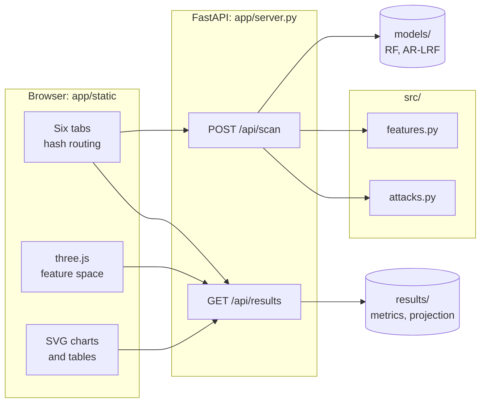

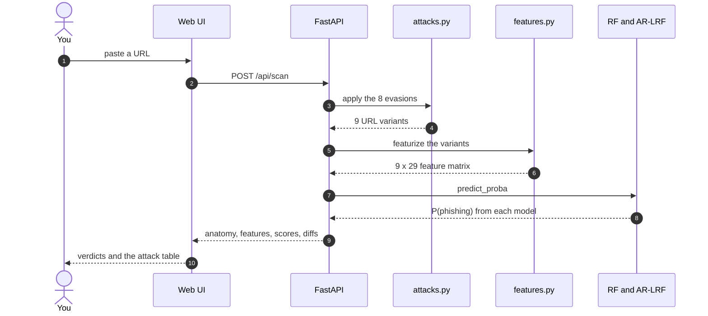

## API

| Method | Path | Returns |
|---|---|---|
| `GET` | `/api/results` | Everything `src/experiment.py` wrote: metrics, robustness table, feature importances, demo predictions, 3D projection |
| `POST` | `/api/scan` | For one URL: its anatomy, 29 features, both models' scores and all eight attacked variants with diffs and scores |
| `GET` | `/api/docs` | Interactive OpenAPI docs |

<details>
<summary><b>Example: <code>POST /api/scan</code></b></summary>

```bash
curl -s http://127.0.0.1:8000/api/scan -H "content-type: application/json" \
     -d '{"url": "http://www.institutohumanus.org.br"}'
```

```jsonc
{
  "url": "http://www.institutohumanus.org.br",
  "scheme_added": false,
  "models_ready": true,
  "anatomy": [
    {"kind": "scheme", "text": "http"}, {"kind": "sep", "text": "://"},
    {"kind": "subdomain", "text": "www"}, {"kind": "sep", "text": "."},
    {"kind": "domain", "text": "institutohumanus"}, {"kind": "sep", "text": "."},
    {"kind": "suffix", "text": "org.br"}
  ],
  "features": [{"name": "url_len", "value": 34.0}, {"name": "host_len", "value": 27.0}, "… 27 more"],
  "scores": {"rf": 1.0, "ar_lrf": 0.9915},
  "variants": [
    {
      "attack": "benign_mimicry",
      "url": "https://www.institutohumanus.org.br",
      "changed": true,
      "diff": [{"op": "equal", "text": "http"}, {"op": "changed", "text": "s"}, {"op": "equal", "text": "://www.institutohumanus.org.br"}],
      "scores": {"rf": 0.0, "ar_lrf": 0.0721}
    }
    // … the other seven attacks
  ]
}
```

</details>

## Project layout

```text
.
├── src/
│   ├── data.py              downloads PhiUSIIL from UCI, flips labels so 1 = phishing, de-duplicates
│   ├── features.py          29 lexical features from the URL string only
│   ├── attacks.py           the 8 evasion attacks
│   ├── experiment.py        clean → attacked → hardened, metrics, figures, models
│   └── predict.py           command-line demo
├── app/
│   ├── server.py            FastAPI: /api/results, /api/scan, static files
│   ├── build_projection.py  3D feature-space projection for the overview
│   └── static/              the web interface (HTML, CSS, ES modules, no build step)
│       ├── css/styles.css
│       └── js/              main.js, charts.js, hero3d.js, views/…
├── results/                 metrics.json, robustness.csv, feature_importance.csv, projection.json, figures/
├── tests/                   features, attacks and API tests
├── docs/screenshots/        images used in this README
├── report.md                full assignment report
└── requirements.txt
```

`data/` (the 56 MB dataset) and `models/` are created by `src/experiment.py` and are not committed.

## Limitations

- **Dataset shortcut.** PhiUSIIL's legitimate URLs share one shape, so clean accuracy overstates what lexical features can do. A 3-feature tree already scores 99.75%.
- **Lexical only.** Domain age, reputation and page content are out of scope by design; they are exactly what would separate a mimicked bare domain from a real one.
- **Smaller than the paper.** 100 trees of depth 20 on 235k public URLs instead of 300 trees of depth 16 on the paper's private 650k URLs; metadata features are not replicated.
- **Attacks are string rewrites.** No adaptive attacker queries the model; results show robustness to fixed transformations, not to an optimised adversary.

## Reference

Chaudhuri, A. and Mohankumar, B. *Adversarial-resilient lightweight phishing URL detection: evaluating lexical & metadata features under evasion techniques.* Scientific Reports 16, 26668 (2026). [doi:10.1038/s41598-026-60046-3](https://doi.org/10.1038/s41598-026-60046-3)

Dataset: *PhiUSIIL Phishing URL Dataset*, UCI Machine Learning Repository, [dataset #967](https://archive.ics.uci.edu/dataset/967/phiusiil+phishing+url+dataset).
